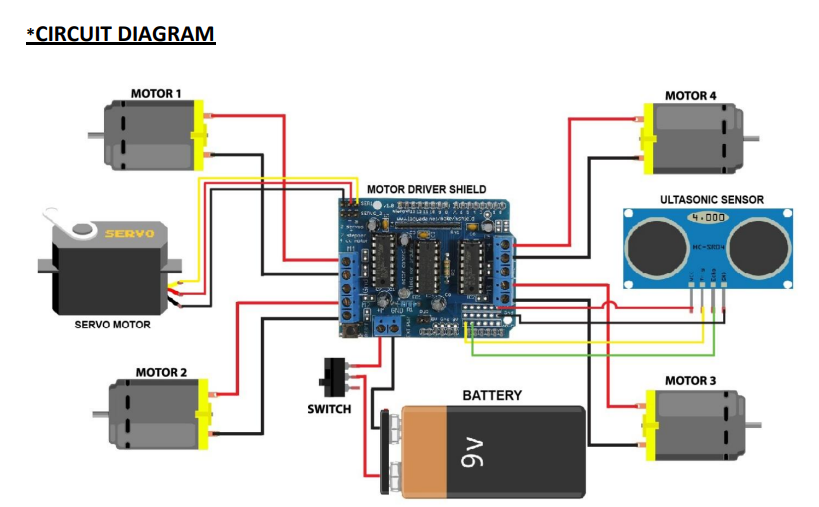

# Obstacle Avoiding Car

## Project Overview
The Obstacle Avoiding Car is an autonomous robotic
vehicle designed to detect obstacles and change its
movement to avoid collisions.

## Objectives
- Detect nearby obstacles using ultrasonic sensing.
- Control the movement of a robotic vehicle.
- Interface sensors with a microcontroller.
- Understand embedded programming and motor control.

## Hardware Components
- Arduino Uno
- HC-SR04 Ultrasonic Sensor
- L298N Motor Driver
- DC Motors
- Robot Chassis and Wheels
- Power Supply
- Connecting Wires

## Working Principle
The HC-SR04 ultrasonic sensor measures the distance
to an obstacle. The Arduino processes the sensor
readings and controls the DC motors through the
L298N motor driver according to the programmed logic.

## Technologies Used
- Arduino Programming
- Embedded Systems
- Ultrasonic Sensor Interfacing
- Motor Control
- Hardware Integration

## Circuit Diagram

## Block Diagram

## Source Code

## Results
### Robot Prototype

## Future Improvements
- Improve obstacle detection and avoidance logic.
- Add additional sensors for better navigation.
- Explore wireless monitoring and control.

## Author
Puneet Janganuri

Electronics and Communication Engineering
